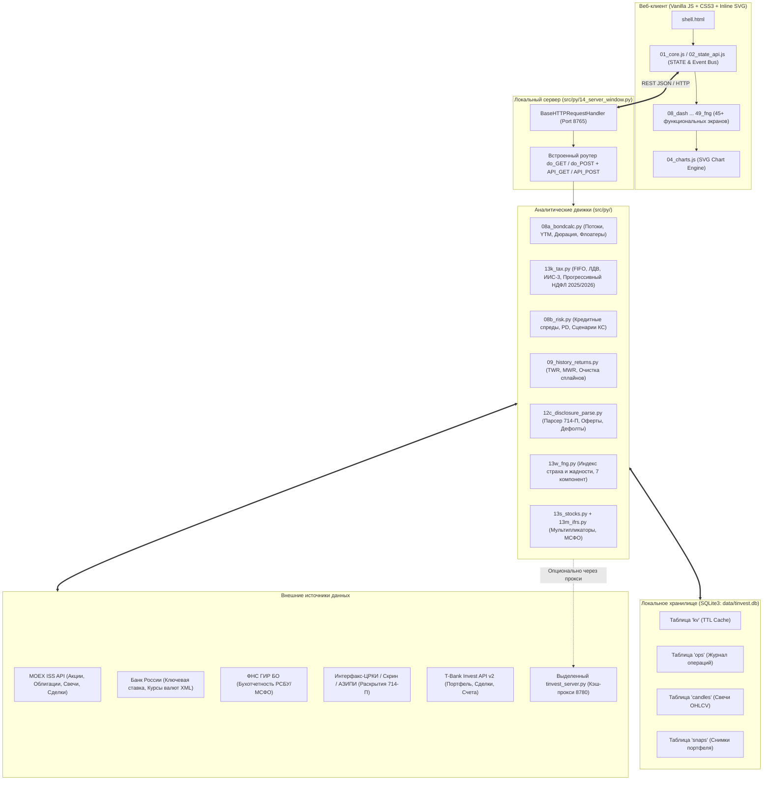
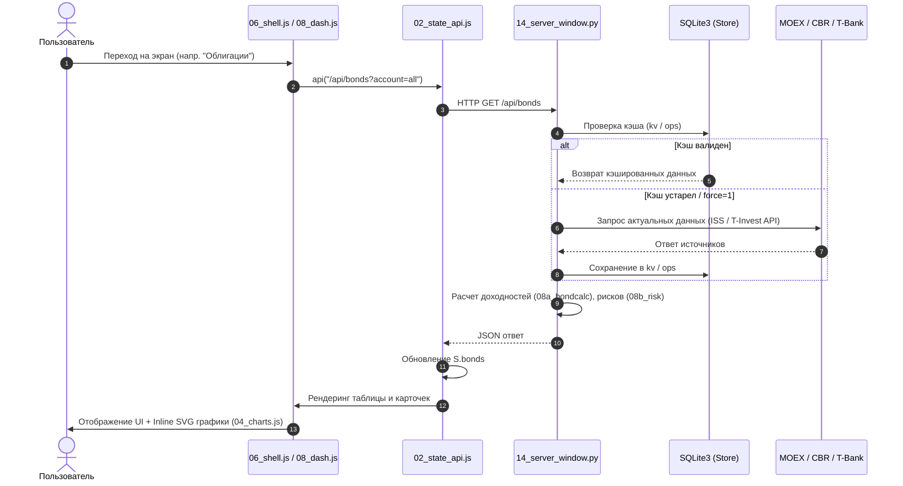

# 🗺️ Архитектурная карта проекта TAnalytic (PROJECT_MAP & GRAPH)
> **Назначение документа**: Исчерпывающая топологическая карта модулей, потоков данных, глобального состояния и API-маршрутов проекта для разработчиков и автономных AI-агентов.  
> **Версия**: 3.0.0 (Актуальность: 2026 год, реалии российского рынка).  
> **Стек**: Python 3.8+ (Zero External Dependencies, только стандартная библиотека), Vanilla ES2020 JS, CSS3, SQLite3, MOEX ISS, ФНС ГИР БО, ЦБ РФ.

---

## 1. Обзор архитектуры и принципов (High-Level Topology)

Проект представляет собой автономную аналитическую платформу для инвесторов на российском рынке. Он может функционировать в двух режимах:
1. **Desktop Client** (`tinvest_analytics.py` / `tinvest.py`): Локальный HTTP-сервер на `127.0.0.1:8765`, взаимодействующий с веб-интерфейсом через системный браузер или Webview (PyQt/PySide/WebView2).
2. **Dedicated Data Server & Workers** (`server/tinvest_server.py`, `server/flows_worker.py`, `server/disclosure_worker.py`): Кэширующий реверс-прокси и фоновые демоны сбора данных (биржевые потоки сделок MOEX, раскрытия информации 714-П, отчетность ГИР БО).

### Архитектурная диаграмма взаимодействия компонентов



---

## 2. Иерархия модулей Python (`src/py/`) и граф зависимостей

Исходные файлы в `src/py/` конкатенируются скриптом `build.py` в алфавитном порядке в монолитный файл `tinvest_analytics.py`. Ниже представлена многоуровневая структура зависимостей:

```mermaid
graph TD
    subgraph L0_Core ["Уровень 0: Базовый фундамент"]
        M01["01_header.py<br/>(Импорты, глобальные STORE, API_GET, API_POST)"]
        M02["02_certs.py<br/>(Минцифры CA сертификаты)"]
        M03["03_config.py<br/>(Конфигурация, токены, настройки)"]
        M04["04_store.py<br/>(SQLite Store: kv, ops, candles, snaps)"]
        M05["05_api_client.py<br/>(HTTP клиент, rate-limiting, pool_map)"]
    end

    subgraph L1_DataIngestion ["Уровень 1: Загрузка и учет операций"]
        M06["06_instruments.py<br/>(Справочник инструментов, типы, валюты)"]
        M07["07_operations.py<br/>(Классификация операций, op_qty, НДФЛ)"]
        M07a["07a_conversions.py<br/>(Редомициляция, сплиты, обмен ГДР/АДР)"]
        M10["10_broker_import.py<br/>(Импорт брокерских отчетов: ВТБ, Сбер, Альфа)"]
        M10a["10a_demo.py<br/>(Демо-портфель)"]
        M11["11_accounts_summary.py<br/>(Агрегация счетов и позиций)"]
    end

    subgraph L2_BondEngines ["Уровень 2: Базовая финансовая математика"]
        M08["08_positions_bonds.py<br/>(Оценка облигационного портфеля)"]
        M08a["08a_bondcalc.py<br/>(Точная математика: MOEX потоки, флоатеры, YTM/YTW)"]
        M08b["08b_risk.py<br/>(Кредитный риск, вероятность дефолта PD, КБД)"]
        M09["09_history_returns.py<br/>(TWR/MWR доходность, очистка от выбросов)"]
    end

    subgraph L3_Parsers ["Уровень 3: Парсеры и внешние коннекторы"]
        M12["12_ext_open.py<br/>(Авторизация и клиент к data_server)"]
        M12a["12a_catalog.py<br/>(Локальный справочник облигаций Т-Банка)"]
        M12b["12b_doctext.py<br/>(Извлечение текста из PDF/HTML/ZIP)"]
        M12c["12c_disclosure_parse.py<br/>(Разбор 714-П сообщений о купонах и дефолтах)"]
        M13["13_ext_market.py<br/>(Скринер MOEX, первичные размещения, КБД)"]
        M13b["13b_keyrate_forecast.py<br/>(Прогноз ключевой ставки ЦБ РФ из PDF/таблиц)"]
        M13m["13m_ifrs.py<br/>(Парсер МСФО smart-lab / отчетности)"]
        M13r["13r_inflation.py<br/>(Парсер недельной инфляции Росстат)"]
    end

    subgraph L4_Analytics ["Уровень 4: Продвинутая аналитика и сервисы"]
        M13a["13a_bondcard.py (Карточка облигации)"]
        M13a1["13a1_bonddocs.py (Эмиссионная документация)"]
        M13c["13c_signals.py (Торговые сигналы и аномалии)"]
        M13d["13d_monitor.py (Мониторинг портфеля и алерты)"]
        M13e["13e_benchmarks.py (Бенчмарки RGBITR, MCFTR)"]
        M13f["13f_calc.py (Инвестиционный калькулятор)"]
        M13h["13h_issuers.py (Карточки эмитентов)"]
        M13i["13i_events.py (Календарь купонов и оферт)"]
        M13j["13j_watch.py (Watchlist, дневник, Telegram)"]
        M13k["13k_tax.py (Налоговый учет: FIFO, ЛДВ, ИИС)"]
        M13l["13l_backup.py (Резервное копирование и экспорт)"]
        M13s["13s_stocks.py (Скринер и мультипликаторы акций)"]
        M13t["13t_ta.py (Технический анализ: RSI, MACD, BB)"]
        M13u["13u_heatmap.py (Карта рынка акций)"]
        M13v["13v_flows.py (Биржевые потоки и крупные сделки)"]
        M13w["13w_fng.py (Индекс страха и жадности)"]
    end

    subgraph L5_Server ["Уровень 5: Сервер и интерфейс"]
        M14["14_server_window.py<br/>(HTTP Handler, роутинг API, безопасность)"]
        M15["15_page.py<br/>(Встраивание HTML шаблона)"]
        M16["16_main.py<br/>(Точка входа CLI, запуск WebView / браузера)"]
    end

    L0_Core --> L1_DataIngestion
    L1_DataIngestion --> L2_BondEngines
    L0_Core --> L3_Parsers
    L2_BondEngines --> L4_Analytics
    L3_Parsers --> L4_Analytics
    L4_Analytics --> L5_Server
```



---

## 3. Архитектура хранилища данных (SQLite3 Schema)

Все данные персистентны и хранятся в единой базе `~/.tinvest/tinvest.db` (или каталоге, переопределенном переменной `TINVEST_HOME`).

| Таблица | Первичный ключ | Назначение | Структура / Поля | Особенности работы |
| :--- | :--- | :--- | :--- | :--- |
| **`kv`** | `k TEXT` | Универсальный кэш со сроком жизни | `k` (ключ), `v` (JSON значение), `t` (Unix timestamp) | Быстрый кэш ответов MOEX ISS, ЦБ РФ, рейтингов. При записи старый ключ перезаписывается. См. BUG-07 (отсутствие фонового purge). |
| **`ops`** | `(acc, id)` | Неизменяемый журнал торговых операций | `acc` (ID счета), `id` (ID операции брокера), `t` (ISO дата), `data` (JSON операции) | Хранит полную историю сделок, пополнений, выводов, комиссий, налогов и конвертаций. |
| **`candles`**| `(figi, tf, t)` | Дневные / часовые свечи инструментов | `figi` (UID инструмента), `tf` (таймфрейм: D/H), `t` (дата/время), `o`, `h`, `l`, `c`, `v` | Используется для расчета TWR/MWR, графиков котировок, теханализа и индекса страха/жадности. |
| **`snaps`** | `(acc, t)` | Снимки оценки портфеля | `acc` (ID счета), `t` (дата YYYY-MM-DD), `data` (JSON состава и оценки) | Фиксирует дневные срезы стоимости активов для быстрого ретроспективного анализа. |

---

## 4. Карта взаимодействия Frontend (`src/web/`)

Фронтенд реализован без сторонних фреймворков (No React/Vue). Вся логика построена на модульном ES2020:
- **`01_core.js`**: Базовые утилиты форматирования денег (`M`, `SM`, `short`), дат (`mlabel`, `dlabel`, `ddm`), инкогнито (`INCOG`), тосты и копирование.
- **`02_state_api.js`**: Глобальный объект состояния `S`, реестры `PAGES`/`NAV_GROUPS`/`IC`, методы `api()`, `post()`, автоподгрузка `staleRefresh()`.
- **`04_charts.js`**: Кастомный движок интерактивных **Inline SVG**-графиков (`bars`, `line`, `donut`, `hbars`, `stackedMonths`, `candles`) + offscreen Canvas для замера ширины подписей (`axisTicks`).
- **`06_shell.js`**: Главный каркас приложения, сайдбар, переключение табов, защита от перерисовки во время ввода (`typingInView`).
- **`08_dash.js` — `49_fng.js`**: Независимые модули экранов (Дашборд, Облигации, Акции, Скринеры, Налоги, Риски, Потоки, F&G, Онбординг, Command Palette).



---

## 5. Таблица ключевых API-эндпоинтов платформы

| Эндпоинт | Метод | Модуль-обработчик | Назначение | Основные параметры |
| :--- | :---: | :--- | :--- | :--- |
| `/api/config` | `GET` / `POST` | `03_config.py`, `14_server_window.py` | Чтение/запись настроек, токенов, темы | `token`, `theme`, `data_server` |
| `/api/summary` | `GET` | `11_accounts_summary.py` | Сводка портфеля, баланс, выплаты | `account`, `period`, `force` |
| `/api/bonds` | `GET` | `08_positions_bonds.py` | Портфель облигаций, дюрация, доходности | `account`, `force` |
| `/api/bond` | `GET` | `13a_bondcard.py` | Детальная карточка выпуска (MOEX потоки) | `isin` |
| `/api/screener` | `GET` | `13_ext_market.py` | Скринер всех обращающихся облигаций MOEX | `force` |
| `/api/history` | `GET` | `09_history_returns.py` | Кривая стоимости, TWR, MWR, бенчмарки | `account`, `force` |
| `/api/tax` | `GET` | `13k_tax.py` | Налоговый расчет: FIFO, ЛДВ, ИИС-3, НДФЛ 2026 | `account`, `year` |
| `/api/tax/settings`| `POST`| `13k_tax.py` | Настройка параметров ИИС и переноса убытков | `iis`, `loss_carry`, `offset_coupons`|
| `/api/risk` | `GET` | `08b_risk.py` | Матрица кредитного риска, PD, стресс-тесты | `account`, `rec` (recovery rate) |
| `/api/calc` | `GET` | `13f_calc.py` | Параметры инвест-калькулятора (КС, инфляция)| `account` |
| `/api/stocks` | `GET` | `13s_stocks.py` | Котировки и фундаментал акций TQBR | `force` |
| `/api/flows` | `GET` | `13v_flows.py` | Денежные потоки, сектора, крупные сделки | `period` |
| `/api/fng` | `GET` | `13w_fng.py` | Индекс страха и жадности (7 компонент) | `force` |
| `/api/backup` | `GET` | `13l_backup.py`, `14_server_window.py` | Экспорт базы и настроек в ZIP-архив | — |

---

## 6. Реестр глобальных переменных и разделяемого состояния

| Переменная | Файл объявления | Тип / Структура | Описание и область видимости | Риски конкурентности |
| :--- | :--- | :--- | :--- | :--- |
| `STORE` | `04_store.py` | Экземпляр `Store` (SQLite3) | Единый интерфейс к SQLite. Подключение с потокобезопасностью через `threading.Lock`. | При параллельных транзакциях используется `_db_lock`. |
| `API_GET`, `API_POST` | `01_header.py` | `dict` `{path: handler_func}` | Глобальный реестр роутов сервера. Заполняется на этапе загрузки модулей. | Мутируется только при старте скрипта. |
| `_mem` | `01_header.py` | `dict` `{key: (ts, data)}` | Быстрый in-memory кэш уровня процесса. | Защищен `_mem_lock`. |
| `_klocks` | `04_store.py` | `dict` `{key: Lock}` | Локи на уровне ключей кэша для исключения гонок при обновлении. | **BUG-05**: Утечка памяти, ключи никогда не удаляются. |
| `_bc_univ` | `08a_bondcalc.py` | `dict` | Кэш параметров графика выплат MOEX. | Обновляется синхронно. |
| `_fng` | `13w_fng.py` | `dict` | Состояние расчета индекса F&G (`running`, `res`, `err`). | Защищен `_fng_lock`. |
| `_flw_cache` | `13v_flows.py` | `dict` | Кэш биржевых потоков по секторам и инструментам. | Защищен внутренним локом. |

---

## 7. Каталог выявленных багов и архитектурных дефектов (BUG Registry)

Ниже сведен полный реестр критических багов и недочетов, выявленных в ходе сквозного аудита:

### 🔴 Критические функциональные баги
- **BUG-01**: Коллизия имени функции `_pdf_cmap` между `13b_keyrate_forecast.py:50` (возвращает `width, mp`) и `13r_inflation.py:39` (возвращает `mp`). В монолите `13r` перетирает `13b`. При распаковке шрифтов ЦБ РФ вызов `width, mp = fonts.get(...)` падает с `ValueError: too many values to unpack (expected 2)`. Парсинг прогнозов ключевой ставки из бюллетеней ЦБ РФ ломается.
- **BUG-02**: Искажение секторов в `server/flows_worker.py:57-67`:
  - `TRMK` (ТМК, металлургия) ошибочно приписан к *"Банки и финансы"*.
  - `SPBE` (СПБ Биржа, финансы) ошибочно приписана к *"Строительство и девелопмент"*.
  - `FESH` (ДВМП / FESCO, транспорт) ошибочно приписан к *"Ритейл и потребление"*.
  - Опечатка тикера `TNFT` (должен быть `TATN`/`TATNP`).  
  *(Примечание: в `13s_stocks.py` секторы указаны корректно — налицо рассинхронизация словарей).*
- **BUG-03**: Падение UI в `src/web/js/11_ratings.js:5`. Метод `ratingTag(r)` вызывает `r.all.map(...)` без предварительной проверки существования массива `r.all`. Если рейтинг передан строкой (напр. `"A+"`) или объектом без поля `all`, фронтенд выбрасывает `TypeError: Cannot read properties of undefined (reading 'map')`, прерывая отрисовку страницы.
- **BUG-04**: Коллизии эмитентов из-за усечения токенов до 5 символов (`t[:5]`) в `08_positions_bonds.py:311`, `13a_bondcard.py:122` и `13d_monitor.py:167`. Такие эмитенты, как *"Интерлизинг"* и *"ИнтерФудГрупп"* схлопываются в `{'интер'}`, а *"Транснефть"*, *"ТрансКонтейнер"* и *"ТрансФин-М"* — в `{'транс'}`. Это искажает расчет концентрации эмитентов и порождает ложные алерты.
- **BUG-10**: Усечение дробных лотов в `07_operations.py:53`. Функция `op_qty(o)` преобразует количество через `int(Decimal(...))`. Для драгоценных металлов (`GLDRUB_TOM`), дробных акций после сплитов/консолидаций и паев БПИФ значения меньше 1.0 (например, `0.5` г золота) обращаются в `0`. Условие `if not q: continue` приводит к полному игнорированию сделки в истории `09_history_returns.py` и налоговом расчете `13k_tax.py`.

### 🟡 Архитектурные риски, безопасность и производительность
- **BUG-05**: Утечка памяти в `04_store.py:114` (`key_lock`). Словарь `_klocks` растет неограниченно по мере обращения к новым инструментам. Требуется использование `weakref` или ограниченного LRU-пула локов.
- **BUG-06**: Уязвимость CSRF / неконтролируемый доступ в `14_server_window.py` (`do_GET`). Заголовок `Sec-Fetch-Site` проверяется только в `do_POST`. Сторонний сайт через скрытый `GET` запрос (``) может инициировать выгрузку базы или DoS-атаку на расчеты (`/api/bonds?force=1`).
- **BUG-07**: Разрастание базы SQLite (`04_store.py`). Записи в таблице `kv` с истекшим сроком годности (TTL) не удаляются автоматически при старте или по расписанию; проверка TTL происходит только в момент чтения ключа.
- **BUG-08**: Мертвый код и пропущенный расчет налога в `08a_bondcalc.py:358` (`yields_by_kind`). Параметр `price` (база для налога) декларируется в сигнатуре и docstring, но внутри функции нигде не используется, а доходность YTW после налога не рассчитывается.
- **BUG-09**: Накладные расходы на многопоточность в `05_api_client.py:202` (`pool_map`). На каждый вызов создается и уничтожается новый `ThreadPoolExecutor`, что создает заметную задержку на macOS и Windows при частых сетевых запросах.

### 🟠 Баги фронтенда, данных потоков и UX/Light Theme (Раунд 3)
- **BUG-11**: Краш UI при невалидном `S.page` из `localStorage` (`02_state_api.js:45`, `06_shell.js:20,92`). Нет валидации `S.page` против `PAGES` — устаревший ключ из старой версии роняет старт приложения с `TypeError`.
- **BUG-12**: Поломанная светлая тема и контрастность (WCAG fail) в 25+ местах CSS: чёрные скелетоны `.sk` на белом фоне (`05_tables_forms.css:39`), нечитаемый жёлтый текст `color: var(--ac)` (`#ffdd2d` на `#fff`, контраст 1.37:1), невидимая нулевая ось графиков `stroke:#ffffff26` (`04_charts.js:41,79`), блеклые `.msg.err`/`.msg.info`.
- **BUG-13**: Сломанная мобильная навигация (`07_mobile.css:7` vs `22_ui.css:2`). Блоки групп `.ng` (`flex-direction: column`) превращают горизонтальную полосу навигации на `<=760px` в громоздкий многострочный блок.
- **BUG-14**: Использование устаревшего `window.event` в `06_shell.js:75` (`render()`). Внутри `async`/`setTimeout` `window.event` равен `undefined`, из-за чего легитимные перерисовки при фокусе в input молча откладываются до `focusout`.
- **BUG-15**: Ошибка объёмов сделок в **10x–10 000x** в режиме собственного токена (`13v_flows.py:126-130`, `_flw_trade_rows` / `_flw_own`): в отличие от `server/tinvest_server.py:406` (`_md_trades`), `p * q` не умножается на размер лота (`lot`) и `face/100` для облигаций. Плюс `datetime.fromisoformat` без regex-фолбэка падает на 9-значных наносекундах в Python 3.8–3.10.
- **BUG-16**: Все **бессрочные облигации** (суборды/вечные) невидимы в скринере (`14_scr.js:3,22`): `new Date(null)` даёт `-56.8` лет, а `r.years > 0` их отбрасывает.
- **BUG-17**: Онбординг (`44_onboard.js:48-49`) сохраняет невалидный токен в `config.json` *до* проверки `/api/test` и жёстко зашивает `sandbox: false` (пользователи песочницы не могут пройти онбординг).
- **BUG-18**: В `10_broker_import.py:179-182` (`parse_num`) числа вида `"1,000,000"` без дробной части ломаются (`float("1.000.000")` -> `None`). В `03_tooltip.js:4-5` тултипы могут улетать за левый/верхний край экрана (отсутствует `Math.max(8, ...)`).

---

## 8. Руководство для AI-агентов (Operational Rules for AI Agents)

При внесении любых изменений в проект AI-агент **ОБЯЗАН** соблюдать следующие правила:
1. **Никаких сторонних библиотек**: Категорически запрещено добавлять `pandas`, `numpy`, `scipy`, `requests`, `fastapi`. Проект строго работает на **Python 3.8+ Standard Library**.
2. **Всегда редактировать исходники в `src/`**: Никогда не редактируйте собранный файл `tinvest_analytics.py` вручную. Все правки должны производиться в `src/py/`, `src/web/js/` или `src/web/css/`.
3. **Обязательная пересборка**: После любых изменений файлов в `src/` необходимо выполнить команду:
   ```bash
   python3 build.py
   ```
4. **Проверка целостности сборки и тесты**:
   ```bash
   python3 build.py --check
   python3 -m pytest
   ```
5. **Опасность пересечения глобальных имен**: Из-за механизма сборки (конкатенация файлов `src/py/*.py` в один модуль) вспомогательные функции, классы и константы с одинаковыми именами в разных файлах могут тихо перезаписывать друг друга (как произошло в BUG-01 с `_pdf_cmap`). Всегда используйте уникальные префиксы модулей (например, `_kr_...` для прогнозов КС, `_inf_...` для инфляции).
6. **Сохранение точности финансовых вычислений**: Расчет процентов, НКД, амортизаций и цен должен производиться с учетом копеек и правил округления финансовых инструментов РФ. При работе с деньгами отдавайте предпочтение `Decimal` либо явно контролируйте точность `float`.
